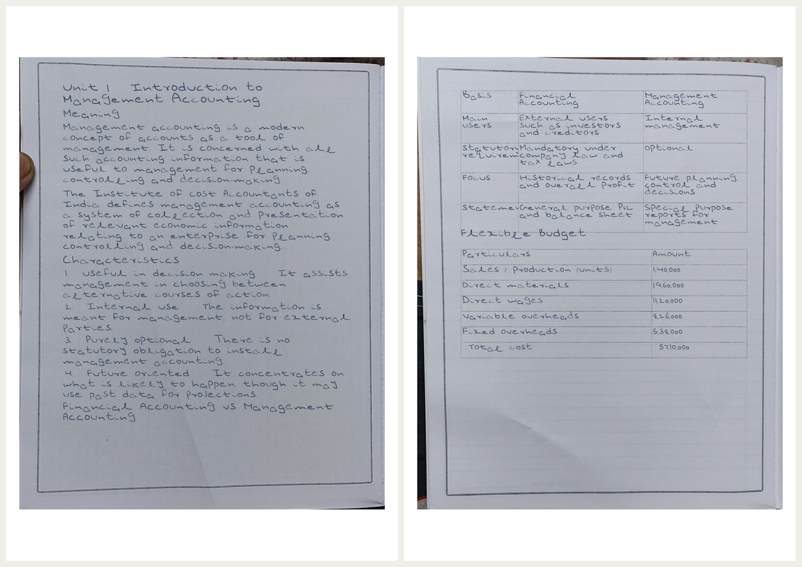

# Handwriting PDF Generator

Turn a Markdown file into a handwritten notebook PDF using a personal letter/digit sample set.

The visual style matches the approved “apex” version:

- **Blue pen handwriting** generated from the supplied glyph samples.
- **Graphite pencil tables** — mostly straight rules with small hand-drawn variations.
- Table cells clip/mask the pencil rules so text never runs through the grid lines.
- **No page numbers** and no unnecessary ruled lines.
- Writing stays inside the printed page frame.
- Original blank-page photos are used as backgrounds (not cleaned or redrawn).



The visual rules and why they work are documented in [`docs/STYLE.md`](docs/STYLE.md).

## Quick start

```bash
python -m pip install -r requirements.txt
```

1. Drop one Markdown file into `input/` (for example `input/notes.md`).
2. Run:

```bash
python generate.py
```

The PDF is written to `output/notes.pdf`.

You can also pass a path explicitly:

```bash
python generate.py examples/sample.md -o output/my-notes.pdf
```

If `input/` contains more than one `.md`, pass the desired file explicitly.

## Markdown format

Use normal Markdown. The generator supports:

- `#`, `##`, `###` headings
- paragraphs
- `1.` numbered lists and `-` bullet lists
- pipe tables (`| ... |`)
- `---` as a page break
- `## Page N ...` headings as page breaks (the heading is not printed)
- front matter for the cover page

### Cover page front matter

```markdown
---
title: Management Accounting Assignment
name: Jai Mehndiratta
roll: 24BC108
section: M
subject: Management Accounting
---
```

Supported keys: `title`, `subtitle`, `name`, `roll`, `class`, `section`, `subject`, `date`, and `cover` (`false` disables the cover).

If no front matter is supplied, the first `#` heading is used as the cover title. To skip the cover entirely, add `cover: false` in front matter (or start the file with content and no title).

### Tables

Tables are rendered as real handwritten grids using pencil. Cells are padded and clipped to the cell box, so numbers and letters stay between the rules. A table that is too tall for the current page is moved to a fresh page; if it is taller than a full page, it stops at the frame rather than spilling outside.

### Page breaks

Use a standalone `---` line, or headings such as `## Page 3`, to start a new page. These are useful when you want exact page boundaries from your source notes.

## Customisation

- **Backgrounds:** replace the images in `assets/backgrounds/` (`page-1.jpeg`, `page-2.jpeg`, `page-3.jpeg`). They must be portrait notebook pages with a printed frame.
- **Letters/digits:** `assets/glyphs.json` contains glyph metadata; glyph images are in `assets/glyphs/`.
- Generated pages are A4 portrait and intentionally have no page numbers.

## Project structure

```
assets/
  backgrounds/       original blank-page photos
  glyphs/            extracted handwriting glyphs
  glyphs.json        glyph metrics and variants
examples/
  sample.md          demo input
handwriting/
  glyphs.py          glyph loading and drawing
  markdown.py        Markdown/front-matter parser
  render.py          pagination, cover, tables, PDF writing
generate.py          command-line entry point
input/               put your Markdown here
output/              generated PDFs
```

## Notes

- The source is Markdown, so material can be re-used and edited without touching code.
- If you want a different pen colour, table scale, or page geometry, change the constants at the top of `handwriting/render.py` and `handwriting/glyphs.py`.
- The handwriting glyphs belong to the person whose samples are in `assets/`; keep that in mind when publishing generated documents.
